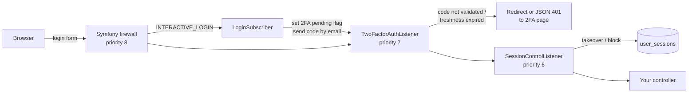

# WlindablaUserBundle

[](#license)


`wlindabla/user-bundle` is a reusable Symfony bundle (namespace `Wlindabla\UserBundle\`) that gives your
application a complete, secure user layer:

- **User management**: a Doctrine user model, canonical fields, email verification, password reset,
  temporary passwords, account activation/deactivation.
- **Two-factor authentication (2FA)** by email code, with a *sliding inactivity window* and an
  *absolute maximum age*.
- **Single-session policy**: one active session per user, with conflict detection between devices.
- **Login history**, **business permissions** and a **double-confirmation email change** flow.
- **SonataAdmin-friendly** design (the bundle has no hard dependency on Sonata).

> **How to read this documentation.** Every statement here comes from reading the bundle source code.
> Where the code is unclear or looks inconsistent, the docs say so. All such points are collected in
> [Known issues and ambiguities](docs/known-issues.md). Please read that page before going to production.

---

## Table of contents

1. [Documentation map](#documentation-map)
2. [Requirements](#requirements)
3. [Quick start](#quick-start)
4. [Optional modules](#optional-modules)
5. [How the pieces fit together](#how-the-pieces-fit-together)
6. [Support and contributing](#support-and-contributing)
7. [License](#license)

---

## Documentation map

| Topic | File | What you will find |
|---|---|---|
| Installation | [docs/installation.md](docs/installation.md) | `composer require`, requirements, what your app must provide (parameters, cache pool, rate limiters…) |
| Configuration | [docs/configuration.md](docs/configuration.md) | Every configuration key, defaults, a full commented YAML example |
| Security integration | [docs/security-integration.md](docs/security-integration.md) | `security.yaml`, `access_control`, listener order and why it matters |
| Entities and migrations | [docs/entities-and-migrations.md](docs/entities-and-migrations.md) | Interfaces to implement, expected columns, repositories, migration examples |
| Routes | [docs/routes.md](docs/routes.md) | How to import routes, list of every route |
| Two-factor authentication | [docs/two-factor-authentication.md](docs/two-factor-authentication.md) | Full 2FA flow, freshness rules, limits |
| Session control | [docs/session-control.md](docs/session-control.md) | `takeover` / `block` policies, revocation reasons, cleanup job |
| Frontend and AJAX | [docs/frontend-ajax.md](docs/frontend-ajax.md) | Redirect mode vs JSON mode, plain JavaScript examples |
| Console commands | [docs/console-commands.md](docs/console-commands.md) | Every CLI command with arguments and examples |
| Events and extensibility | [docs/events-and-extensibility.md](docs/events-and-extensibility.md) | Events, templates, translations, services you can replace |
| Email change module | [docs/email-change.md](docs/email-change.md) | How to implement the validator policy, entities, controllers (with examples) |
| Related bundles | [docs/related-bundles.md](docs/related-bundles.md) | Configuration of `share-service-bundle` and `mailing-bundle`, which this bundle needs |
| Example application | [docs/example-application.md](docs/example-application.md) | A real, working integration (SonataAdmin + 2FA + single session + Redis) explained |
| Admin integration | [docs/admin-integration.md](docs/admin-integration.md) | `MicroUserCRUDActionTrait`, Sonata admin/CRUD controllers, and how to use the bundle with EasyAdmin or custom controllers |
| Known issues | [docs/known-issues.md](docs/known-issues.md) | Inconsistencies and ambiguities found in the code |

---

## Requirements

| Requirement | Version |
|---|---|
| PHP | `>= 8.3` |
| Symfony components | `^6.4 \| ^7.4 \| ^8.0` |
| Doctrine ORM | `^3.0` |
| DoctrineBundle | `^2.11 \| ^3.0` |
| Database | PostgreSQL is the reference. Some repository methods are PostgreSQL-only (see [entities](docs/entities-and-migrations.md#postgresql-specific-features)) |

The full dependency list (including `wlindabla/share-service-bundle`, `wlindabla/mailing-bundle`,
`vich/uploader-bundle` and `odolbeau/phone-number-bundle`) is in [docs/installation.md](docs/installation.md).

---

## Quick start

> This is the shortest path. Each step links to the page with all the details.

**1. Install the bundle**

```bash
composer require wlindabla/user-bundle
```

**2. Create your entities** (a `User` entity at minimum) by extending the bundle's mapped superclasses.
See [entities and migrations](docs/entities-and-migrations.md).

```php
<?php
// src/Entity/User.php
namespace App\Entity;

use App\Repository\UserRepository;
use Doctrine\ORM\Mapping as ORM;
use Wlindabla\UserBundle\Infrastructure\Doctrine\BaseUser;

#[ORM\Entity(repositoryClass: UserRepository::class)]
#[ORM\Table(name: 'users')]
class User extends BaseUser
{
   #[ORM\Id]
    #[ORM\GeneratedValue('IDENTITY')]
    #[ORM\Column(type: "integer")]
    #[Groups(['user:cache', 'user:security', 'user:read'])]
    protected int|string|null $id = null;
} 
```

**3. Configure the bundle**

```yaml
# config/packages/wlindabla_user.yaml
wlindabla_user:
    classes:
        user: App\Entity\User
```

**4. Import the routes**

```yaml
# config/routes/wlindabla_user.yaml
wlindabla_user:
    resource: '@WlindablaUserBundle/config/routes.php'
```

**5. Wire the user provider and login in `security.yaml`**

```yaml
# config/packages/security.yaml
security:
    providers:
        app_user_provider:
            id: Wlindabla\UserBundle\Infrastructure\Security\Provider\UserProvider
    firewalls:
        main:
            lazy: true
            provider: app_user_provider
            form_login:
                login_path: wlindabla_user_login
                check_path: wlindabla_user_login
            logout:
                path: wlindabla_user_logout
```

**6. Define the parameter the bundle needs**

```yaml
# config/services.yaml
parameters:
    app.site_name: 'My Application'
```

**7. Generate and run the migration**

```bash
php bin/console doctrine:migrations:diff
php bin/console doctrine:migrations:migrate
```

Then enable the optional modules you want (2FA, single-session policy, …). See below.

---

## Optional modules

The **core** module (user, login/logout pages, email verification, password reset) is always loaded.
All other modules are switched on by setting entity classes under `wlindabla_user.classes`.

| Module | Enabled when… | Extra required config | What it adds |
|---|---|---|---|
| Core | `classes.user` is set (required) | — | User manager, user provider, login page, email verification, password reset, console commands |
| User session | `classes.user_session` is set | `session_control.firewall_name` | Single-session policy, conflict page, session cleanup, revoke commands |
| Login logger | `classes.logger_login_user` is set | — | Stores each successful interactive login |
| Two-factor | `classes.two_factor_code` is set | `two_factor.firewall_name` | Email code challenge, freshness rules, 2FA pages |
| Permission | all four of `permission_role`, `permission_group`, `user_permission_role`, `user_permission_group` | — | Business permissions and groups, `AuthorizationCheckerForUserInterface` |
| Email change | both `email_change_request` and `email_change_validation` | — | Double-confirmation email change flow and its 3 routes |

If you set only *part* of the Permission or Email change classes, the container build fails with a
`LogicException` that tells you what is missing.

---

## How the pieces fit together



The two request listeners run **after** the Symfony firewall and **in a fixed order**: first the
second-factor check, then the single-session check. Why this order matters is explained in
[Security integration](docs/security-integration.md#listener-order-and-why-it-matters).

Many background tasks (login logging, session activity, sending 2FA codes, hashing a password changed in
an admin form) are sent through `AsyncMethodDispatcherInterface` from `wlindabla/share-service-bundle`.
This means **a Messenger worker must be running** in production. See
[installation](docs/installation.md#messenger-and-the-async-dispatcher).

---

## Support and contributing

- Issues and pull requests: use the GitHub repository of the project.
- Run the test suite with `vendor/bin/phpunit` (config: `phpunit.xml.dist`).

## License

MIT. 
- Author: **AGBOKOUDJO Franck** <internationaleswebservices@gmail.com>
- Phone: +229 01 67 25 18 86
- LinkedIn: https://www.linkedin.com/in/internationales-web-apps-services-120520193/
- Company: INTERNATIONALES WEB APPS & SERVICES
