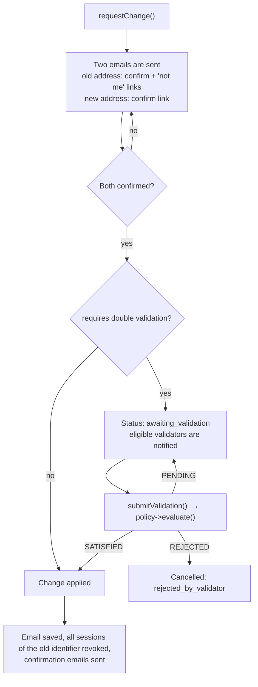

# Email change module (your application provides the rules)

[← Back to the README](../README.md)

The email change module lets an account change its email address safely, with **double confirmation** (old
address and new address) and, if you want, a **vote of validators** before the change is applied.

> **By design, the bundle does not decide who may validate a change.** That is a business rule of *your*
> application (a committee, a flat permission, a fixed list of administrators…). The bundle ships only the
> contract, `EmailChangeValidatorPolicyInterface`. **You must write one class** and register it. This page
> shows how, step by step, with working examples.

## Contents

- [How the flow works](#how-the-flow-works)
- [What you must do (checklist)](#what-you-must-do-checklist)
- [Step 1: enable the module](#step-1-enable-the-module)
- [Step 2: create the entities and repositories](#step-2-create-the-entities-and-repositories)
- [Step 3: write the validator policy](#step-3-write-the-validator-policy)
- [Step 4: register the services](#step-4-register-the-services)
- [Step 5: start a change from your own controller](#step-5-start-a-change-from-your-own-controller)
- [Step 6: let validators vote](#step-6-let-validators-vote)
- [Security, mail and workers](#security-mail-and-workers)
- [Recovery procedure](#recovery-procedure)
- [Rules and statuses at a glance](#rules-and-statuses-at-a-glance)

---

## How the flow works



The service that runs this flow is `EmailChangeRequestServiceInterface` (implemented by the bundle's
`EmailChangeRequestService`). It asks your policy **every** question about "who" and "how many".

Facts taken from the source:

- Tokens are random, sent by email, and stored **only as hashes**.
- A request is valid for `email_change.token_lifetime` seconds (default `3600`). An expired request is marked
  `expired` the next time someone tries to use it.
- Only one active request per account. After a cancelled request, a new one is refused until
  `email_change.retry_cooldown` seconds (default `86400`) have passed since that request was made.
- The "double validation" (the vote) is **required** when someone changes the email of *another* account. It is
  skipped only when the user changes **their own** email **and** has one of the roles in
  `email_change.exempt_roles_on_self` (default `['ROLE_SUPER_ADMIN']`).
- When the change is applied, the bundle saves the new email, revokes every active session of the **old**
  identifier (reason `security_email_changed`) and sends the notifications. Remember-me cookies stop working
  by themselves, because the user identifier is the email.

---

## What you must do (checklist)

| # | Task | Required? |
|---|---|---|
| 1 | Set both `classes.email_change_request` and `classes.email_change_validation` | yes |
| 2 | Create two entities and two repositories that extend the bundle's classes | yes |
| 3 | Write a class that implements `EmailChangeValidatorPolicyInterface` | **yes** |
| 4 | Register the policy and alias the repositories | yes |
| 5 | Call `requestChange()` from a controller of yours (the bundle has no "start" page) | yes |
| 6 | Give validators a way to vote (call `submitValidation()`), when double validation is used | yes if you use it |
| 7 | Run a Messenger worker (the emails are sent asynchronously) | yes |

If you forget step 3, the container fails to build, because `EmailChangeRequestService` needs a
`EmailChangeValidatorPolicyInterface` and nothing provides it. This is expected, not a bug.

---

## Step 1: enable the module

```yaml
# config/packages/wlindabla_user.yaml
wlindabla_user:
    classes:
        user: App\Entity\User
        email_change_request: App\Entity\EmailChangeRequest
        email_change_validation: App\Entity\EmailChangeValidation
    email_change:
        token_lifetime: 3600                  # seconds
        retry_cooldown: 86400                 # seconds
        exempt_roles_on_self: ['ROLE_SUPER_ADMIN']
        recovery_initiator_role: 'ROLE_SUPER_ADMIN'
```

Both classes are required together; setting only one stops the build with a `LogicException`.
The three public routes (`/email-change/confirm-old/…`, `/confirm-new/…`, `/not-me/…`) are enabled with the
module. See [routes](routes.md) and [security](security-integration.md).

---

## Step 2: create the entities and repositories

```php
<?php
// src/Entity/EmailChangeRequest.php
namespace App\Entity;

use App\Repository\EmailChangeRequestRepository;
use Doctrine\ORM\Mapping as ORM;
use Wlindabla\UserBundle\Infrastructure\Doctrine\EmailChangeRequest as BaseEmailChangeRequest;

#[ORM\Entity(repositoryClass: EmailChangeRequestRepository::class)]
#[ORM\Table(name: 'email_change_requests')]
class EmailChangeRequest extends BaseEmailChangeRequest {}
```

```php
<?php
// src/Entity/EmailChangeValidation.php
namespace App\Entity;

use App\Repository\EmailChangeValidationRepository;
use Doctrine\ORM\Mapping as ORM;
use Wlindabla\UserBundle\Infrastructure\Doctrine\EmailChangeValidation as BaseEmailChangeValidation;

#[ORM\Entity(repositoryClass: EmailChangeValidationRepository::class)]
#[ORM\Table(name: 'email_change_validations')]
#[ORM\UniqueConstraint(name: 'uniq_email_change_validator', columns: ['email_change_request_id', 'validator_id'])]
class EmailChangeValidation extends BaseEmailChangeValidation {}
```

```php
<?php
// src/Repository/EmailChangeRequestRepository.php
namespace App\Repository;

use App\Entity\EmailChangeRequest;
use Doctrine\Persistence\ManagerRegistry;
use Wlindabla\UserBundle\Infrastructure\Doctrine\Repository\AbstractEmailChangeRequestRepository;

final class EmailChangeRequestRepository extends AbstractEmailChangeRequestRepository
{
    public function __construct(ManagerRegistry $registry)
    {
        parent::__construct($registry, EmailChangeRequest::class);
    }
}
```

```php
<?php
// src/Repository/EmailChangeValidationRepository.php
namespace App\Repository;

use App\Entity\EmailChangeValidation;
use Doctrine\Persistence\ManagerRegistry;
use Wlindabla\UserBundle\Infrastructure\Doctrine\Repository\AbstractEmailChangeValidationRepository;

final class EmailChangeValidationRepository extends AbstractEmailChangeValidationRepository
{
    public function __construct(ManagerRegistry $registry)
    {
        parent::__construct($registry, EmailChangeValidation::class);
    }
}
```

Then generate the migration (`doctrine:migrations:diff`, `doctrine:migrations:migrate`). Check the column names
of the unique constraint with `doctrine:schema:validate`, as explained in
[entities and migrations](entities-and-migrations.md).

---

## Step 3: write the validator policy

The interface has **three methods**:

| Method | Question it answers | Returns |
|---|---|---|
| `resolveEligibility($request, $candidate)` | "May this user vote on this request, and under which title?" | A string (the title, saved as the validator's role) or `null` if not eligible. **It must return `null` when the candidate is the target user** (no self-validation). |
| `evaluate($request, $decisions)` | "With the votes so far, what is the verdict?" | `EmailChangeValidationOutcome::SATISFIED`, `REJECTED` or `PENDING` |
| `listEligibleValidatorEmails($request)` | "Who must be notified that a vote is needed?" | A list of email addresses |

`evaluate()` is called right after every new vote. Compute the result from `$decisions` each time; do not cache it.

**Example: two administrators must approve, and one rejection stops everything.**

```php
<?php
// src/EmailChange/AdminQuorumValidatorPolicy.php
namespace App\EmailChange;

use App\Repository\UserRepository;
use Wlindabla\UserBundle\Domain\EmailChange\Application\Manager\EmailChangeValidatorPolicyInterface;
use Wlindabla\UserBundle\Domain\EmailChange\Enum\EmailChangeValidationOutcome;
use Wlindabla\UserBundle\Domain\EmailChange\Model\EmailChangeRequestInterface;
use Wlindabla\UserBundle\Domain\User\Model\BaseUserInterface;

final class AdminQuorumValidatorPolicy implements EmailChangeValidatorPolicyInterface
{
    private const REQUIRED_APPROVALS = 2;

    public function __construct(private readonly UserRepository $users)
    {
    }

    public function resolveEligibility(EmailChangeRequestInterface $request, BaseUserInterface $candidate): ?string
    {
        // Rule 1: nobody validates a change on their own account.
        if ($candidate->getId() === $request->getTargetUser()?->getId()) {
            return null;
        }

        // Rule 2: only administrators can vote. The returned string is stored with the vote.
        if ($candidate->hasRole('ROLE_SUPER_ADMIN')) {
            return 'ROLE_SUPER_ADMIN';
        }

        if ($candidate->hasRole('ROLE_ADMIN')) {
            return 'ROLE_ADMIN';
        }

        return null;
    }

    public function evaluate(EmailChangeRequestInterface $request, iterable $decisions): EmailChangeValidationOutcome
    {
        $approvals = 0;

        foreach ($decisions as $decision) {
            if (!$decision->isApproved()) {
                return EmailChangeValidationOutcome::REJECTED;   // one "no" is enough
            }
            ++$approvals;
        }

        return $approvals >= self::REQUIRED_APPROVALS
            ? EmailChangeValidationOutcome::SATISFIED
            : EmailChangeValidationOutcome::PENDING;
    }

    public function listEligibleValidatorEmails(EmailChangeRequestInterface $request): array
    {
        $targetEmail = $request->getTargetUser()?->getEmail();

        // findActiveEmailsByRole() comes from the bundle's AbstractUserRepository (see the note below).
        $emails = array_merge(
            $this->users->findActiveEmailsByRole('ROLE_SUPER_ADMIN'),
            $this->users->findActiveEmailsByRole('ROLE_ADMIN'),
        );

        // The target account never validates its own change.
        return array_values(array_unique(array_filter(
            $emails,
            static fn (string $email): bool => $email !== $targetEmail,
        )));
    }
}
```

> `UserRepository` is **your** repository. If it extends the bundle's `AbstractUserRepository`, it already has
> `findActiveEmailsByRole(string $role, ?\DateTimeImmutable $createdBefore = null): array` (emails of enabled
> accounts holding a role). That method is **PostgreSQL-specific**: it needs a `json`/`jsonb` roles column and the
> `JSONB_EXISTS` DQL function (`scienta/doctrine-json-functions`). On another database, override it in your
> repository or write your own query ([installation](installation.md#dependencies-you-add-yourself-and-postgresql)).

**Other rules you can implement in the same three methods**

- *One approval from a super administrator is enough:* in `evaluate()`, return `SATISFIED` when a decision
  has `getValidatorRole() === 'ROLE_SUPER_ADMIN'` and `isApproved()`.
- *A fixed list of validators:* in `resolveEligibility()`, compare `$candidate->getEmail()` with a list from
  a parameter.
- *No vote at all:* you still need a policy class (the service requires it), but you can leave
  `exempt_roles_on_self` to cover self-changes. A change of *another* account always requires validation.

---

## Step 4: register the services

```yaml
# config/services.yaml
services:
    _defaults:
        autowire: true
        autoconfigure: true

    App\:
        resource: '../src/'

    # 1) Your policy
    Wlindabla\UserBundle\Domain\EmailChange\Application\Manager\EmailChangeValidatorPolicyInterface:
        alias: App\EmailChange\AdminQuorumValidatorPolicy

    # 2) The bundle's service is typed with the abstract repository classes, so alias those too
    Wlindabla\UserBundle\Infrastructure\Doctrine\Repository\AbstractEmailChangeRequestRepository:
        alias: App\Repository\EmailChangeRequestRepository
    Wlindabla\UserBundle\Infrastructure\Doctrine\Repository\AbstractEmailChangeValidationRepository:
        alias: App\Repository\EmailChangeValidationRepository

    # 3) Needed if you type-hint the repository interface in your own controllers (Step 6)
    Wlindabla\UserBundle\Domain\EmailChange\Model\Persistance\EmailChangeRequestRepositoryInterface:
        alias: App\Repository\EmailChangeRequestRepository
```

The mailer service `EmailChangeRequestMailerService` is added to the async whitelist by the bundle itself.
You do not need to list it.

---

## Step 5: start a change from your own controller

The bundle has **no page to start a change**. Call `EmailChangeRequestServiceInterface::requestChange()`
where it makes sense in your application (profile page, admin screen…).

```php
<?php
// src/Controller/EmailChangeController.php
namespace App\Controller;

use App\Repository\UserRepository;
use Symfony\Bundle\FrameworkBundle\Controller\AbstractController;
use Symfony\Component\HttpFoundation\Request;
use Symfony\Component\HttpFoundation\Response;
use Symfony\Component\Routing\Attribute\Route;
use Wlindabla\UserBundle\Domain\EmailChange\Application\Manager\EmailChangeRequestServiceInterface;
use Wlindabla\UserBundle\Domain\User\Model\BaseUserInterface;

final class EmailChangeController extends AbstractController
{
    #[Route('/account/email/change', name: 'app_email_change_request', methods: ['POST'])]
    public function request(
        Request $request,
        EmailChangeRequestServiceInterface $emailChange,
        UserRepository $users,
    ): Response {
        /** @var BaseUserInterface $me */
        $me = $this->getUser();

        if (!$this->isCsrfTokenValid('email_change', (string) $request->request->get('_token'))) {
            throw $this->createAccessDeniedException();
        }

        $newEmail = trim((string) $request->request->get('new_email'));
        if (!filter_var($newEmail, FILTER_VALIDATE_EMAIL)) {
            $this->addFlash('error', 'Please enter a valid email address.');

            return $this->redirectToRoute('app_profile');
        }

        // Changing my own email. To change someone else's, load that user and pass it as $targetUser.
        // (Your own code must decide who is allowed to do that, for example with a Voter.)
        try {
            $emailChange->requestChange(requestedBy: $me, targetUser: $me, newEmail: $newEmail);
            $this->addFlash('success', 'We sent confirmation links to your old and new addresses.');
        } catch (\DomainException $e) {
            // Examples: a request is already active, the cooldown is not over, the account has no email.
            $this->addFlash('error', $e->getMessage());
        }

        return $this->redirectToRoute('app_profile');
    }
}
```

`requestChange()` throws `\DomainException` for business refusals (active request, cooldown). Catch it and show
the message. The service does **not** check that the new address is valid or free: do it before the call.

---

## Step 6: let validators vote

When double validation applies, the request waits in status `awaiting_validation`. Each eligible validator
receives an email (the addresses come from your policy). You provide the screen where they decide:

```php
#[Route('/admin/email-change/{id}/decision', name: 'app_email_change_decision', methods: ['POST'])]
public function decide(
    int $id,
    Request $request,
    EmailChangeRequestRepositoryInterface $requests,
    EmailChangeRequestServiceInterface $emailChange,
): Response {
    /** @var BaseUserInterface $me */
    $me = $this->getUser();
    $emailChangeRequest = $requests->find($id) ?? throw $this->createNotFoundException();

    $approved = 'approve' === $request->request->get('decision');
    $comment  = trim((string) $request->request->get('comment')) ?: null;   // mandatory when rejecting

    try {
        $emailChange->submitValidation($emailChangeRequest, $me, $approved, $comment);
        $this->addFlash('success', 'Your decision was recorded.');
    } catch (\DomainException $e) {
        // Not awaiting validation, already voted, not eligible, or no reason given for a rejection.
        $this->addFlash('error', $e->getMessage());
    }

    return $this->redirectToRoute('app_email_change_list');
}
```

(`EmailChangeRequestRepositoryInterface` is `Wlindabla\UserBundle\Domain\EmailChange\Model\Persistance\EmailChangeRequestRepositoryInterface`.)

`submitValidation()` checks, in this order: the request is `awaiting_validation`; the user has not voted yet;
your policy says the user is eligible; a comment exists when rejecting. It then saves the vote, calls your
`evaluate()` and acts on the verdict.

> The bundle's `MicroUserCRUDActionTrait` already contains `approveAction` / `rejectAction` (POST, AJAX) that
> call `submitValidation()`. They work with SonataAdmin, EasyAdmin or any controller: see
> [admin-integration.md](admin-integration.md).
---

## Security, mail and workers

- **Public links.** The three confirmation links come from emails. Make them publicly reachable:
  `- { path: ^/email-change/, roles: PUBLIC_ACCESS }` ([security integration](security-integration.md)).
- **Mail.** The module sends 6 kinds of email (old address notice, new address confirmation, applied
  notice, "not me" alert, validators pending, outcome). Their templates are listed in
  [configuration](configuration.md) and can be replaced ([templates](events-and-extensibility.md#templates)).
- **Worker.** Mails are dispatched with the async dispatcher: a Messenger worker must be running
  ([installation](installation.md#messenger-and-the-async-dispatcher)).
- **"This is not me".** The link in the old-address email cancels the request (reason `not_me`) and triggers a
  security alert email.

---

## Recovery procedure

When the user lost access to the old address, someone holding `email_change.recovery_initiator_role` (default
`ROLE_SUPER_ADMIN`) can call:

```php
$emailChange->requestRecovery(requestedBy: $admin, targetUser: $lockedOutUser, newEmail: 'new@example.com');
```

Differences with a normal change: no email is sent to the old address, only the new address must be confirmed,
and the **validator vote is always required**, even for an exempt role. Anyone without the initiator role gets a
`\DomainException`.

---

## Rules and statuses at a glance

| Status (`EmailChangeRequestStatus`) | Meaning |
|---|---|
| `pending` | Waiting for the confirmation(s) from the email links |
| `awaiting_validation` | Both addresses confirmed; waiting for validators |
| `confirmed` | Applied |
| `cancelled` | Stopped. Reason: `not_me`, `rejected_by_validator` or `expired` (`EmailChangeCancelReason`) |
| `expired` | Token lifetime passed |

| `EmailChangeValidationOutcome` (returned by your `evaluate()`) | Effect |
|---|---|
| `SATISFIED` | The change is applied |
| `REJECTED` | The request is cancelled (`rejected_by_validator`) and the requester is notified |
| `PENDING` | Nothing happens yet; wait for more votes |

Back to: [README](../README.md)
