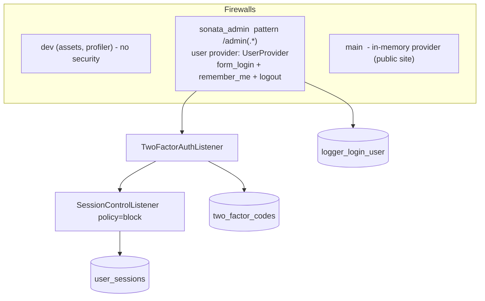

# Example application

[← Back to the README](../README.md)

This page walks through a **real application** that uses the bundle: a Symfony 7.4 / PHP 8.4 publishing
platform with SonataAdmin, API Platform, Redis and FrankenPHP. Everything below is taken from its
configuration files. Use it as a worked example, and adapt the names to your project.

What this application enables:

- the user bundle with **single-session policy (`block`)**, **login history** and **2FA by email**;
- an administration firewall named `sonata_admin` (pattern `/admin`);
- Redis for cache, sessions and rate limiting;
- Messenger transports for emails and background tasks.

## Contents

- [The big picture](#the-big-picture)
- [Bundle configuration](#bundle-configuration)
- [Security](#security)
- [Entities and repositories](#entities-and-repositories)
- [Services wiring](#services-wiring)
- [Cache pools and rate limiters](#cache-pools-and-rate-limiters)
- [Messenger, mail and ShareService](#messenger-mail-and-shareservice)
- [Template overrides](#template-overrides)
- [Things this example teaches](#things-this-example-teaches)
- [Things to improve in the example](#things-to-improve-in-the-example)

---

## The big picture



Only the `sonata_admin` firewall is guarded by the bundle (`firewall_name: sonata_admin` in both modules).
The public website uses the `main` firewall and is **not** touched by the 2FA or session listeners.

---

## Bundle configuration

```yaml
# config/packages/wlindabla_user.yaml
wlindabla_user:
    classes:
        user: App\Entity\SonataUser
        logger_login_user: App\Entity\LoggerLoginUser
        user_session: App\Entity\UserSession
        two_factor_code: App\Entity\TwoFactorCode
    default_role: ROLE_ADMIN                      # no effect and deprecated, see "Things to improve"
    routes:
        home: app_home
        login: wlindabla_sonata_admin_user_login
        login_path: '/admin/form/login'
        logout: wlindabla_sonata_admin_user_logout
        logout_path: '/admin/form/logout'
        dashboard: sonata_admin_dashboard
    security:
        user_cache_ttl: '%env(int:USER_PROVIDER_CACHE_TTL)%'
    session_control:
        firewall_name: sonata_admin
        policy: 'block'                           # a second device is refused while one session is active
    two_factor:
        firewall_name: sonata_admin
        inactivity_threshold_seconds: 1800        # 30 minutes of inactivity => new code
        absolute_cap_seconds: 28800               # 8 hours = one working session
        activity_touch_throttle_seconds: 60
        support_ajax_json_response: true          # AJAX gets JSON 401 (see frontend-ajax.md)
        allowed_routes_while_pending:
            - wlindabla_sonata_admin_user_login
            - wlindabla_sonata_admin_user_logout
            - wlindabla_user_two_factor_show
            - wlindabla_user_two_factor_verify
            - wlindabla_user_two_factor_resend
            - wlindabla_user_password_reset_request
            - wlindabla_user_password_reset_confirm
```

Routes are imported with the standard file:

```yaml
# config/routes/wlindabla_user.yaml
wlindabla_user:
    resource: '@WlindablaUserBundle/config/routes.php'
```

The routes file also declares the logout route itself (`wlindabla_sonata_admin_user_logout`, path
`/admin/form/logout`) next to the bundle's own route of the same resolved name, because Symfony's
`security.route_loader.logout` is imported in the same file. Keep one definition per name in your own project.

---

## Security

```yaml
# config/packages/security.yaml (shortened)
security:
    password_hashers:
        Symfony\Component\Security\Core\User\PasswordAuthenticatedUserInterface: 'auto'

    providers:
        users_in_memory: { memory: null }
        wlindabla_user_admin:
            id: Wlindabla\UserBundle\Infrastructure\Security\Provider\UserProvider

    session_fixation_strategy: migrate

    firewalls:
        dev:
            pattern: ^/(_profiler|_wdt|assets|build)/
            security: false

        sonata_admin:
            context: user
            lazy: true
            pattern: /admin(.*)
            provider: wlindabla_user_admin
            login_throttling:
                max_attempts: 3
            form_login:
                username_parameter: _username
                password_parameter: _password
                enable_csrf: true
                login_path: wlindabla_sonata_admin_user_login
                check_path: wlindabla_sonata_admin_user_login
                default_target_path: sonata_admin_dashboard
            remember_me:
                secret: '%env(APP_SECRET)%'
                lifetime: 604800
                path: /admin
            logout:
                path: wlindabla_sonata_admin_user_logout
                target: wlindabla_sonata_admin_user_login
                clear_site_data: [cookies, storage]

        main:
            lazy: true
            provider: users_in_memory

    access_control:
        - { path: ^/admin/form/login$,  role: PUBLIC_ACCESS }
        - { path: ^/admin/form/logout$, role: PUBLIC_ACCESS }
        - { path: ^/verify-email/*,     role: PUBLIC_ACCESS }
        - { path: ^/api/admin/,         roles: ROLE_ADMIN }
        - { path: ^/admin,              roles: ROLE_ADMIN }
```

Points worth copying:

- **A dedicated firewall for the guarded area.** Because the pattern is `/admin(.*)`, the public pages of the
  bundle that live outside it (`/verify-email/…`, `/forget_password/…`, `/session-conflict/…`) are not
  protected by this firewall at all. That is why they need no `PUBLIC_ACCESS` rule here, and why the 2FA
  listener (which only acts on the guarded firewall) ignores them.
- **`login_throttling`** is Symfony's own brute-force protection and works next to the bundle.
- `session_fixation_strategy: migrate` is the default: the session id changes after login, which is exactly why
  the bundle registers the session on the *next* request ([why](security-integration.md#listener-order-and-why-it-matters)).
- A long **role hierarchy** (not shown) shows that the bundle does not interfere with your own roles.

---

## Entities and repositories

The `User` entity extends `BaseUser` and adds application fields. It also overrides the default role through
the class constant (this is the part that really works):

```php
#[ORM\Entity(repositoryClass: SonataUserRepository::class)]
#[ORM\Table(name: 'sonata_user')]
#[Vich\Uploadable]
#[Gedmo\SoftDeleteable]
class SonataUser extends BaseUser
{
    use SoftDeleteableEntity;
    public const string ROLE_DEFAULT = 'ROLE_ADMIN';

    #[ORM\Column(type: 'string', length: 200, nullable: true)]
    protected ?string $profile = null;
    // ... country, isMember, team fields
}
```

The other entities map their own identifier, as explained in
[entities](entities-and-migrations.md#other-entities):

```php
#[ORM\Entity(repositoryClass: TwoFactorCodeRepository::class)]
class TwoFactorCode extends BaseTwoFactorCode
{
    #[ORM\Id] #[ORM\GeneratedValue] #[ORM\Column(type: 'integer')]
    protected int|string|null $id = null;
}

#[ORM\Entity(repositoryClass: UserSessionRepository::class)]
#[ORM\Table(name: 'user_sessions')]
#[ORM\Index(columns: ['user_identifier'], name: 'idx_user_session_identifier')]
#[ORM\Index(columns: ['session_id'], name: 'idx_user_session_id')]
#[ORM\Index(columns: ['last_activity_at'], name: 'idx_user_session_last_activity')]
#[ORM\Index(columns: ['active'], name: 'idx_user_session_active')]
class UserSession extends AbstractUserSession {}
```

Repositories extend the abstract ones and receive their caches with `#[Target]`:

```php
final class TwoFactorCodeRepository extends AbstractTwoFactorCodeRepository
{
    public function __construct(ManagerRegistry $registry)
    {
        parent::__construct($registry, TwoFactorCode::class);
    }
}

final class UserSessionRepository extends AbstractUserSessionRepository
{
    public function __construct(
        ManagerRegistry $registry,
        #[Target('session.cache_pool')] private readonly CacheItemPoolInterface $cache,
    ) {
        parent::__construct($registry, UserSession::class, $cache);
    }
}
```

The application also uses `Gedmo SoftDeleteable` on the session and login-log entities. That is optional.
Doctrine is configured with `phone_number: Misd\PhoneNumberBundle\Doctrine\DBAL\Types\PhoneNumberType`,
the naming strategy `underscore_number_aware`, and the DQL functions `JSONB_EXISTS` and friends from
`scienta/doctrine-json-functions` (needed by the role-based repository finders).

---

## Services wiring

The explicit wiring done in `config/services.yaml`. Each block answers a point from the
[installation checklist](installation.md#what-your-application-must-provide).

```yaml
parameters:
    app.site_name: "ProTIC Editions & Services"   # required by the bundle
    app.env: "%env(APP_ENV)%"                     # required by wlindabla:user:create

services:
    # PHP sessions in Redis, with a known prefix
    Symfony\Component\HttpFoundation\Session\Storage\Handler\RedisSessionHandler:
        arguments:
            - '@Redis'
            - { 'prefix': 'protic_sess:', 'ttl': 3600 }

    Redis:
        class: \Redis
        lazy: true
        calls:
            - connect: ['%env(REDIS_HOST)%', '%env(int:REDIS_PORT)%']

    # Evict revoked sessions from Redis (same prefix as the session handler above)
    Wlindabla\UserBundle\Infrastructure\UserSession\RedisSessionStoreEvictor:
        arguments:
            $redis: '@Redis'
            $prefix: 'protic_sess:'

    Wlindabla\UserBundle\Domain\UserSession\Application\Service\SessionStoreEvictorInterface:
        '@Wlindabla\UserBundle\Infrastructure\UserSession\RedisSessionStoreEvictor'

    # Tag-aware cache pool for the user provider
    Wlindabla\UserBundle\Infrastructure\Security\Provider\UserProvider:
        arguments:
            $userCacheProvider: '@wlindabla_user.cache_pool'

    # Repository interfaces -> your repositories
    Wlindabla\UserBundle\Domain\User\Model\Persistance\UserRepositoryInterface:
        alias: App\Repository\SonataUserRepository
    Wlindabla\UserBundle\Domain\User\Model\Persistance\UserFindDuplicatesRepositoryInterface:
        alias: App\Repository\SonataUserRepository
    Wlindabla\UserBundle\Domain\UserSession\Model\Persistance\UserSessionRepositoryInterface:
        alias: App\Repository\UserSessionRepository
    Wlindabla\UserBundle\Domain\LoggerLoginUser\Model\Persistance\LoggerLoginUserRepositoryInterface:
        alias: App\Repository\LoggerLoginUserRepository
    Wlindabla\UserBundle\Domain\TwoFactorAuth\Model\Persistance\TwoFactorCodeRepositoryInterface:
        alias: App\Repository\TwoFactorCodeRepository
```

This confirms three things documented elsewhere:

1. The **Redis eviction** has to be wired by hand, with the prefix equal to the session handler's prefix
   ([session control](session-control.md#redis-session-eviction)).
2. The **user cache pool** is bound explicitly with `$userCacheProvider`
   ([installation](installation.md#2-a-tag-aware-cache-pool-for-the-user-provider)).
3. **Repository interfaces** are aliased to your repositories
   ([entities](entities-and-migrations.md#repositories)).

The application also declares `IdEncryptionRequestArgumentValueResolver` (tag `controller.argument_value_resolver`,
priority 999) and `IdEncryptionService` (`$encryptionKey: '%env(APP_ID_ENCRYPTION_KEY)%'`) by hand, with
`autoconfigure: false`. According to the ShareServiceBundle README, this is optional (the bundle registers them
when `encryption_key` is set); declaring them yourself gives you control of the resolver priority and of the key
source. See [Related bundles](related-bundles.md#declaring-the-id-encryption-services-yourself-optional) for the
block to copy.

---

## Cache pools and rate limiters

```yaml
# config/packages/cache.yaml (the pools used by the bundle)
framework:
    cache:
        app: cache.adapter.redis
        default_redis_provider: '%env(CACHE_REPOSITORY_REDIS_DSN)%'
        pools:
            wlindabla_user.cache_pool:                 # bound to UserProvider above
                adapter: cache.adapter.redis
                tags: true
            session.cache_pool:                        # injected into UserSessionRepository with #[Target]
                adapter: cache.adapter.redis
                tags: true
                default_lifetime: 7200
            cache.rate_limiter:
                adapter: cache.adapter.redis
                default_lifetime: 3600
                tags: false
```

```yaml
# config/packages/rate_limiter.yaml (the two limiters the bundle asks for)
framework:
    rate_limiter:
        password_reset:
            policy: fixed_window
            limit: 3
            interval: '30 minutes'
            lock_factory: lock.default.factory
            cache_pool: cache.rate_limiter

        two_factor_resend:
            policy: 'sliding_window'
            limit: 3
            interval: '1 minute'
```

No alias is added for these two limiters: the `#[Target('password_reset')]` and `#[Target('two_factor_resend')]`
arguments of the bundle's controllers resolve on their own in this Symfony 7.4 project. The application also
has its own limiters (login, API, global) used by an application listener that is not part of the bundle.
The lock is configured with `framework.lock: '%env(LOCK_DSN)%'`.

---

## Messenger, mail and ShareService

```yaml
# config/packages/messenger.yaml (shortened)
framework:
    messenger:
        failure_transport: failed
        transports:
            email_transport:
                dsn: '%env(MESSENGER_TRANSPORT_EMAIL_DSN)%'
            async_app_transport:
                dsn: '%env(MESSENGER_TRANSPORT_APP_DSN)%'
                retry_strategy: { max_retries: 4, multiplier: 2 }
            failed:
                dsn: '%env(MESSENGER_TRANSPORT_FAILED_DSN)%'
        routing:
            Symfony\Component\Mailer\Messenger\SendEmailMessage: email_transport
            Wlindabla\ShareServiceBundle\Messenger\Message\ServiceMethodMessage: async_app_transport
```

`wlindabla_share_service.yaml` and `wlindabla_mailing.yaml` of the application are the models for the
examples in [Related bundles](related-bundles.md): its `allowed_services` lists **only its own** handlers,
never the user bundle's.

Processes to run in production: `messenger:consume async_app_transport`,
`messenger:consume email_transport`, and (for the session cleanup) the scheduler transport
([session control](session-control.md#automatic-cleanup)).

---

## Template overrides

The application has a `templates/bundles/WlindablaUserBundle/` directory and a `templates/session_conflict/`
directory: it replaces bundle templates with its own, using Symfony's standard bundle template override
([extensibility](events-and-extensibility.md#templates)).

---

## Things this example teaches

| Choice in the example | Why it is a good idea |
|---|---|
| One firewall (`sonata_admin`) for 2FA **and** session control | The two listeners must guard the same perimeter |
| `policy: block` | Stricter than the default `takeover`: nobody can kick an admin out by logging in elsewhere |
| 2FA inactivity of 30 min, cap of 8 h | Matches a working day. Defaults are 2 h and 24 h |
| `support_ajax_json_response: true` | Sonata pages make many AJAX calls; JSON is easier to handle than a followed redirect |
| `session_fixation_strategy: migrate` | Required by the way sessions are registered |
| Redis eviction with the **same prefix** as the session handler | A revoked session is really removed from Redis |
| Its own handlers in `allowed_services` only | The user bundle manages its own whitelist |

---

## Things to improve in the example

These come from comparing the example with the rest of this documentation. They are suggestions, not errors
that stop the application.

1. **`default_role: ROLE_ADMIN` has no effect, and is now deprecated.** The bundle never reads that option and raises
   a deprecation notice when it is set. What works is the class constant `ROLE_DEFAULT` in the entity. Remove the
   YAML line. Note too that every account of this application is an administrator by design, which is acceptable
   only if no non-admin account can ever exist in that table.
2. **`session_control.excluded_routes` is no longer needed here.** The bundle now skips the three 2FA routes and
   the login and logout routes by itself, so a session is not registered before the code is validated
   ([details](known-issues.md#session-registered-before-2fa)). The same is true for
   `allowed_routes_while_pending`: the example's list of 7 routes is now redundant (it is harmless).
3. **`two_factor_resend` limiter** has no `cache_pool`. With several FrankenPHP workers, counters are not shared
   unless the limiter uses a shared cache pool (the other limiters use `cache.rate_limiter`). The file's own
   comments say the same.
4. **Remember-me and 2FA.** The cookie lasts 7 days (`lifetime: 604800`) but the 2FA absolute cap is 8 hours:
   a remember-me user will be asked for a code again, which is the intended behaviour of the freshness rules.
   Just make sure the session `max_duration_hours` (default 24 h) fits with the way you want it to behave.
5. **`USER_PROVIDER_CACHE_TTL`** should be much smaller than `inactivity_threshold_seconds` (1800 here), see
   [two-factor tuning](two-factor-authentication.md#tuning-advice).

Back to: [README](../README.md)
