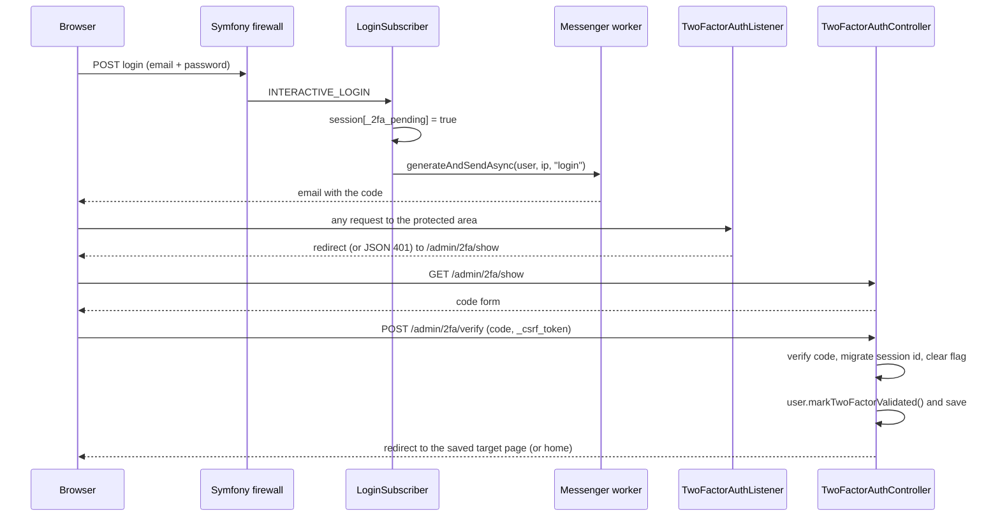
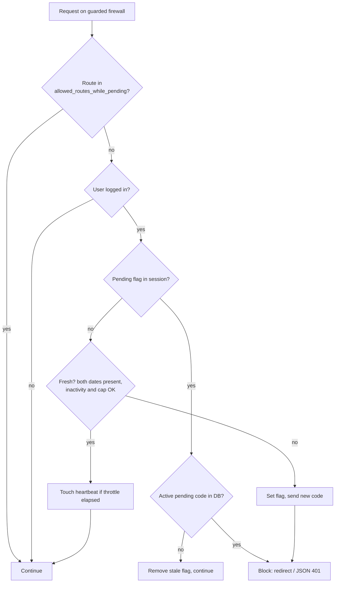

# Two-factor authentication (2FA)

[← Back to the README](../README.md)

2FA is an **optional module**. It is switched on when `wlindabla_user.classes.two_factor_code` is set.
After a correct password, the user receives a one-time code by email and must enter it before reaching the
protected area. The module also re-asks for a code when the user has been idle for too long, or when too much
time has passed since the last validation.

## Contents

- [Enable it](#enable-it)
- [The flow step by step](#the-flow-step-by-step)
- [Freshness rules](#freshness-rules)
- [Limits built into the code](#limits-built-into-the-code)
- [How blocked requests are answered](#how-blocked-requests-are-answered)
- [Behaviour worth knowing](#behaviour-worth-knowing)
- [Tuning advice](#tuning-advice)

---

## Enable it

Minimum steps (details in the other pages):

1. Create the `TwoFactorCode` entity and its repository ([entities](entities-and-migrations.md#other-entities)).
2. Make sure your `User` has the two freshness columns (they come with `BaseUser`) and run a migration.
3. Configure the bundle:

```yaml
wlindabla_user:
    classes:
        two_factor_code: App\Entity\TwoFactorCode
    two_factor:
        firewall_name: main
        allowed_routes_while_pending:
            - wlindabla_user_two_factor_show
            - wlindabla_user_two_factor_verify
            - wlindabla_user_two_factor_resend
            - wlindabla_user_logout
```

4. Define the `two_factor_resend` rate limiter ([installation](installation.md#3-rate-limiters)).
5. Run a Messenger worker, because the code is generated and sent asynchronously
   ([installation](installation.md#messenger-and-the-async-dispatcher)).

---

## The flow step by step



In words:

1. **Login.** After a correct password, `LoginSubscriber::onRequireTwoFactor` sets the session key
   `_2fa_pending = true` **first**, then dispatches `TwoFactorCodeManagerInterface::generateAndSendAsync()`
   (context `login`). The flag is set before sending so that a mail failure cannot let the user in without a
   second factor.
2. **Code creation.** `TwoFactorCodeManager` first checks the per-account send limit, invalidates the user's
   previous `PENDING` codes, generates a new code with `MfaCodeGeneratorInterface`, stores **only its hash**
   (`TokenHasherInterface`), saves a row with a 10-minute expiry and sends the email with the template
   `two_factor_code_email`.
3. **Blocking.** On each request of the guarded firewall, `TwoFactorAuthListener` (priority 7) checks the
   state. A pending code blocks the request, except for routes in `allowed_routes_while_pending`.
4. **Verification.** `POST /admin/2fa/verify` checks the CSRF token (id `two_factor_verify`) and the code.
   The code is normalised (spaces removed, upper-cased) before the hash comparison.
5. **Success.** The PHP session id is regenerated (`migrate(true)`), the pending flag is removed, the user's
   `twoFactorValidatedAt` and `twoFactorLastCheckedAt` are set to *now* (UTC) and saved, and the cached user is
   invalidated. The user is sent to the page they originally asked for (the saved *target path*), or to the home
   route.

---

## Freshness rules

When there is **no pending flag** in the session, the listener does not simply trust the session. It checks
two dates stored on the **account** (not in the PHP session, so they survive a new session or a remember-me
login):

| Rule | Field used | Setting | Default | Meaning |
|---|---|---|---|---|
| Sliding inactivity window | `twoFactorLastCheckedAt` | `inactivity_threshold_seconds` | 7200 (2 h) | If `now − lastCheckedAt` is bigger, the user must enter a new code. |
| Absolute cap | `twoFactorValidatedAt` | `absolute_cap_seconds` | 86400 (24 h) | If `now − validatedAt` is bigger, a new code is required **even if the user was always active**. |
| Heartbeat throttle | `twoFactorLastCheckedAt` | `activity_touch_throttle_seconds` | 300 (5 min) | `lastCheckedAt` is updated at most this often, to avoid a database write on every request. |

The first rule to fail makes the state *stale*. **If either date is missing**, the state is also stale
(fail closed). The listener then sets the pending flag and dispatches a new code (context
`remember_me_refresh`), and blocks the request.

A failure while writing the heartbeat is logged and ignored: it never blocks an already-legitimate request.



---

## Limits built into the code

These are constants of `TwoFactorCodeInterface`; they are not configurable in YAML.

| Limit | Value |
|---|---|
| Code lifetime | 10 minutes |
| Wrong attempts per code | 5, then the code is `LOCKED` |
| Codes that can be sent per account | 3 per 15 minutes |
| Per-IP resend limit | Whatever you configure in the `two_factor_resend` limiter |

Code statuses (`TwoFactorCodeStatus`): `pending`, `verified`, `expired`, `locked`.

Exceptions and their HTTP effect in `TwoFactorAuthController`:

| Exception | Used when | Response |
|---|---|---|
| `InvalidTwoFactorCodeException` | No pending code, expired code, wrong code | `422` (AJAX) or flash + redirect |
| `TwoFactorCodeLockedException` | The code reached 5 wrong attempts | `423` (AJAX) or flash + redirect |
| `TwoFactorSendThrottledException` | More than 3 sends in 15 minutes | `429` |
| `TooManyRequestsHttpException` | The per-IP limiter refuses | `429`, `Retry-After: 60` |

---

## How blocked requests are answered

When the listener blocks a request it answers in one of two ways, controlled by
`two_factor.support_ajax_json_response`:

| Mode | Normal navigation | AJAX request (`X-Requested-With: XMLHttpRequest`) |
|---|---|---|
| `false` (default) | `302` to the 2FA page | `302` to the 2FA page (the frontend must notice it) |
| `true` | `302` to the 2FA page | `401` + JSON `{"success": false, "twoFactorRequired": true, "redirect": "/admin/2fa/show"}` |

The full explanation and JavaScript examples are in [Frontend and AJAX](frontend-ajax.md).

The *target path* (the page to return to after validation) is saved only for **non-AJAX** requests, so a
background request can never overwrite the real page the user wanted.

---

## Behaviour worth knowing

These points come from reading the code. They are observations, not promises.

1. **A locked code is replaced by asking for a new one.** After 5 wrong attempts the row becomes `LOCKED`.
   The lookup of the "current" code only looks at `PENDING` rows, so later attempts get the generic
   "invalid code" error, and the user can press *resend* to get a new code (limited to 3 per 15 minutes per
   account and by the IP limiter). The message of the locked exception says "contact an administrator", but the
   bundle has no unlock command. Plan your own policy if you need a hard lock.
2. **Resend can report success even if the email failed.** `TwoFactorCodeManager::createCodeAndSend()` catches
   every exception, logs it at `critical` level and returns `null`; the controller does not check the return
   value. Watch your logs.
3. **Codes are sent asynchronously at login.** If your worker is down, users will not receive a code, but they
   will still be blocked (the flag is set first). The *resend* button works synchronously.
4. **Unexpected user class.** If the logged-in user does not implement the bundle's `UserInterface`,
   the listener denies access (fail closed) and logs a warning.
5. **Session id change.** After a successful verification the PHP session id is regenerated.
   `SessionControlListener` then finds no row for the new id and, if no registration is pending, creates one
   silently. See [session control](session-control.md).
6. **User cache and freshness.** `UserProvider` can serve a cached copy of the user. The 2FA freshness dates
   are part of the cached data (`user:cache` group). The controller invalidates the cache after a successful
   validation. The heartbeat write does **not** invalidate it.

---

## Tuning advice

- Keep `activity_touch_throttle_seconds` **much smaller** than `inactivity_threshold_seconds`
  (defaults: 300 s vs 7200 s).
- Keep `security.user_cache_ttl` **much smaller** than `inactivity_threshold_seconds` too. (This is our
  inference from point 6 above: a long cache lifetime could serve an old `twoFactorLastCheckedAt`.)
- Always add the three 2FA routes and your logout route to `allowed_routes_while_pending`.
- Customise the page with the `two_factor_show` template and the email with `two_factor_code_email`
  ([templates](events-and-extensibility.md#templates)).

Back to: [README](../README.md) · Next: [Session control](session-control.md)
